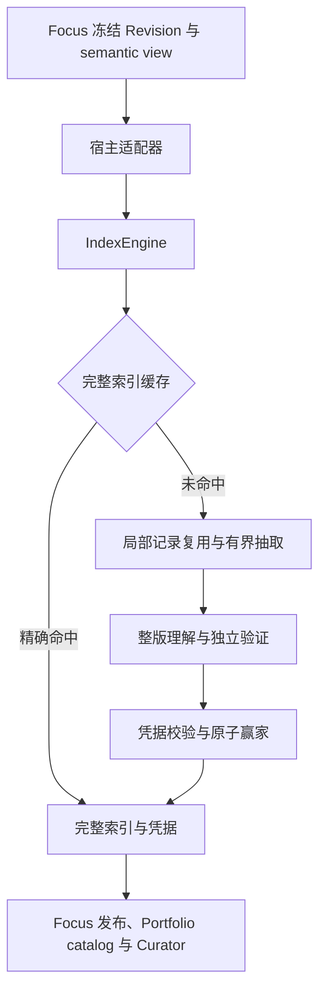

# 边界与首版约束

独立引擎接收冻结的语义消息版本，产出完整索引、局部与整体凭据、质量账本和本次运行统计。源码基线为 [Focus `08fe98c`](https://github.com/Leeminjing/Focus/commit/08fe98c28896992c6195912e95b507599b9dcd76)。

| 模块 | 职责 |
|---|---|
| `api.py` | Snapshot、Policy、Authorization、Artifact、运行统计与进度 |
| `engine.py` | 构建合并、取消回收、基线校验、有界局部 workers 与发布 |
| `semantic_indexer.py` | 原始消息规范化、工具交换原子、稳定分组 |
| `semantic_grounding.py` | 逐字引文、宿主资格、独立支持 verdict |
| `segment_projection.py` | 局部抽取与不可变局部凭据 |
| `interpretation_inputs.py` / `revision_interpretation.py` | 完整目录、可替换原文窗口、累计阅读依赖与整版理解 |
| `interpretation_record.py` / `semantic_index.py` | 来源、完整覆盖、哈希、历史格式与整体 proof 校验 |
| `ports.py` / `model_runtime.py` | 模型工厂、逐次准入／结算、请求容量预检与验证重试 |
| `stores.py` / `admission.py` | 可替换存储和单进程预算实现 |
| `focus_adapter.py` | Focus 冻结消息与独立 Snapshot 的转换 |

## 缓存与继承

完整缓存键同时包含命名空间、完整来源身份、宿主内容 hash、规范消息全文、角色与目标，以及 schema、分组和模型合同。相同宿主 hash 搭配不同正文不会命中。

局部缓存以 `(namespace, context_id, local_contract + segment identity)` 隔离。合同覆盖 prompt、输出 schema、grounding／verifier 版本、模型身份与分组参数。改变整体理解模型可以复用兼容局部结果；改变局部模型会使局部合同失效。

Baseline 是宿主确认可继承的祖先 Artifact。引擎重新检查其凭据、命名空间、Context、代际、局部合同、完整消息前缀和相等的稳定分组；业务上的发布状态和演化链由宿主证明。前缀不等时计划回退 full；完整性损坏直接失败。处于同 Context 的相同局部内容仍可独立命中局部缓存，不代表继承了旧整版结论。

新内容始终触发整版解释。完整目录、局部 record identities 和实际读过的全部原文都进入 proof；没有被最终引用的阅读内容同样被校验。窗口替换只减少单次送模原文，不能抹掉阅读审计。

## 模型、消费与授权

一个 `invoke` 对应一个物理模型尝试，模型实例由工厂独立创建。`cache_identity` 必须覆盖 Provider、模型版本、采样及输出配置，不能包含密钥。引擎在调用及发布前核对配置身份，验证失败后的重试也重新准入和结算。Provider 传输重试也必须进入宿主的实际用量凭据。

模型可实现 `estimate_request_tokens(schema, system, payload)`，提供真实请求格式的估算；默认采用迁入的 CJK／文本启发式，计入 schema、system、payload 与输出预留。启发式不是 Provider tokenizer。Focus 示例复用其真实请求序列化估算器。

`Admission.authorize` 在任何缓存读取前检查当前访问范围；`reserve` 在每次实际调用前预留；`settle` 必须幂等且可在取消后完成。默认实现按 `(owner_id, grant_id)` 共享额度，新授权或修改限制需要新 grant_id。缓存命中不生成调用费用；已完成的局部记录允许后续获得授权的请求复用。进行中的工作只有相同授权才能合并。

`last_attempt_records` 中的 `model_calls`、`input_tokens`、`output_tokens` 用于记录 Provider 用量；`usage_reported=false` 或缺少 token 字段时显示未知。没有底层凭据时，调用次数记为一次适配器尝试，不推断实际账单。默认 Admission 对未知 token 仍保留估算／预留收费，避免未知消费被视为免费。跨进程准确预算和执行所有权需要宿主实现 Admission。

## 兼容与范围

为允许 Focus 直接校验返回值，首版保留 `ContextRevisionRef` 的历史 wire 字段，包括精确 checkpoint 寻址；它们在库中只用于来源标识，不访问执行系统。库不导入 `backend`、`focus`、SQLAlchemy，也不识别 Loop、Mission 或 Patrol 数据表。证据只接受版本化消息引用。

历史 v3–v9 Index、旧 grounding proof 的读取规则保留在迁入代码中；自动化覆盖原始 v9 golden payload、旧 grounding payload 和完整新产物的上游校验。未声称对所有历史生产样本完成兼容认证。新的整体编排合同单独带版本，旧整体缓存不会静默冒充新引擎结果；局部 hash 算法保持。

SQLite 每个操作使用独立短连接，在 worker thread 完成事务。`INSERT OR IGNORE` 后读取赢家。没有模型调用持有事务。多个进程可以保存／读取同一赢家，但仍可能重复调用模型。默认模型名额保持 Focus 的前台优先／后台单名额行为，还没有按 Context 做公平调度。
